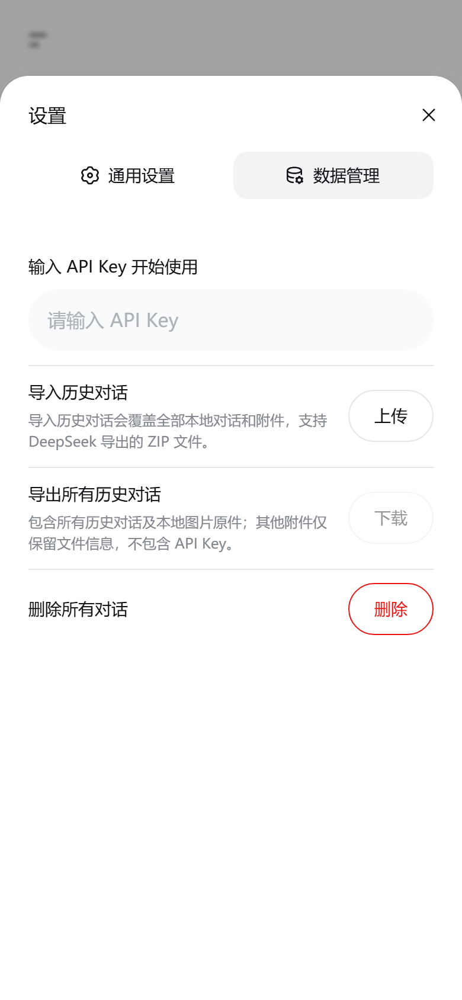
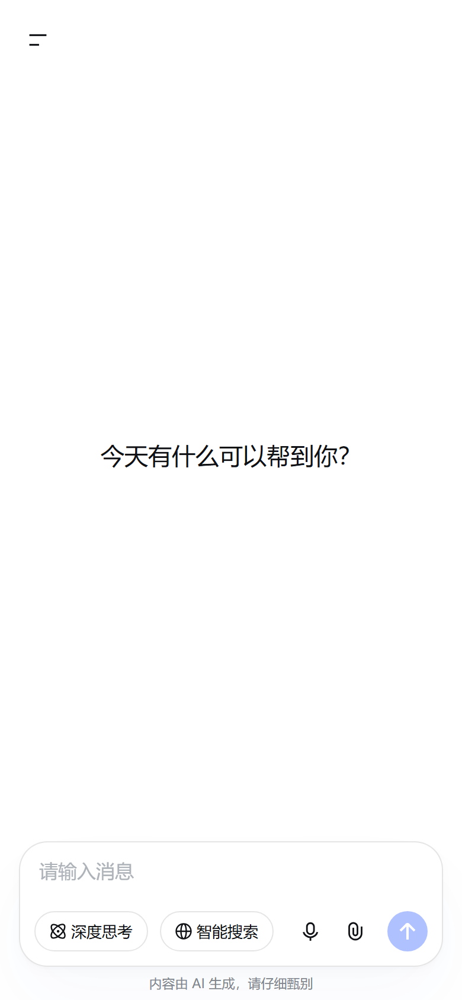
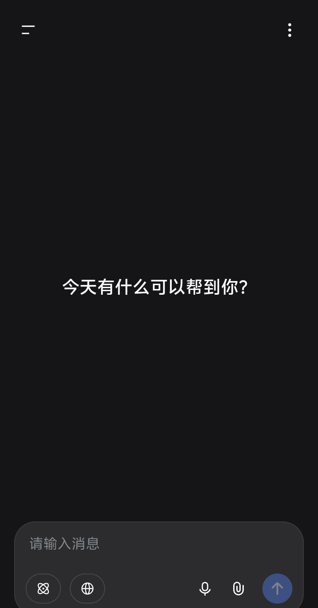
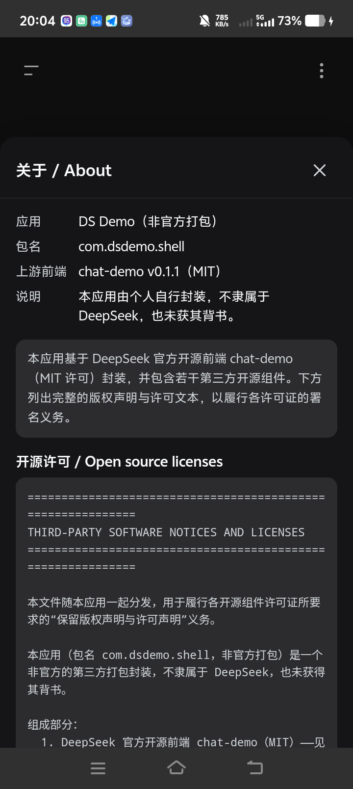
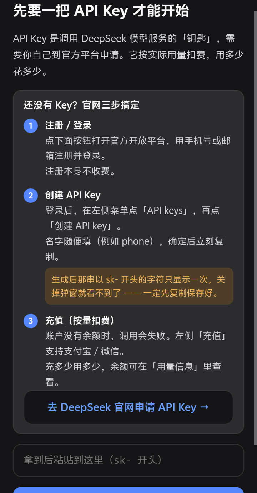
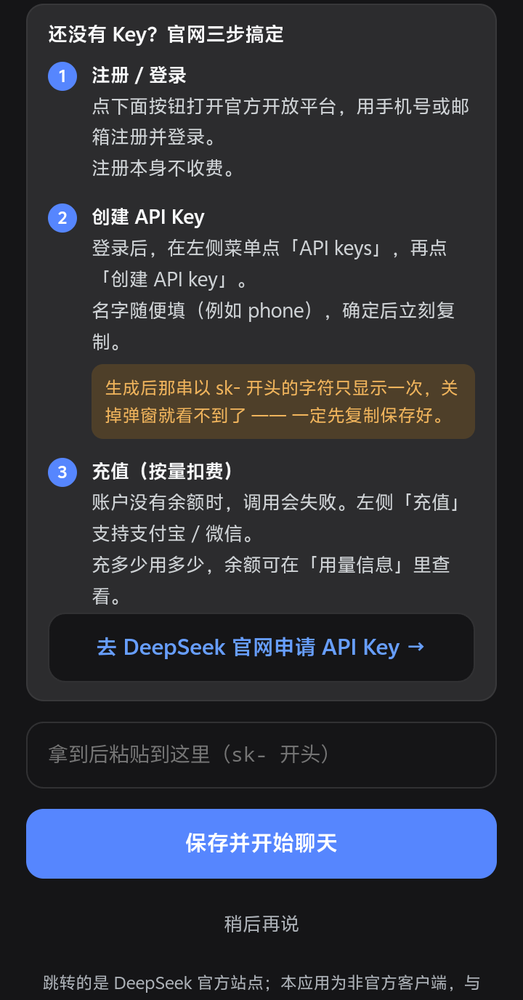
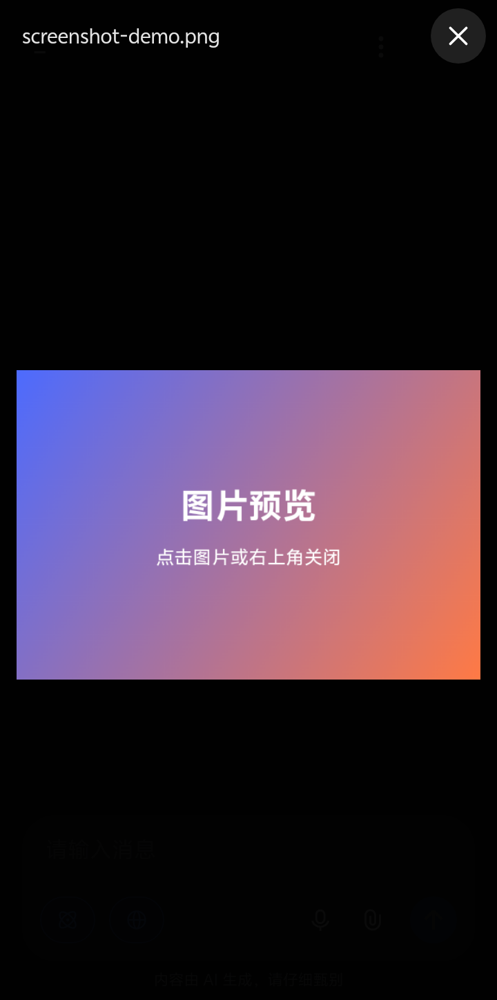
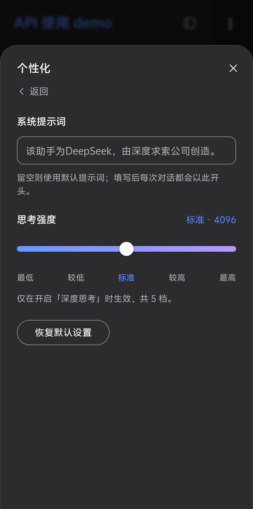
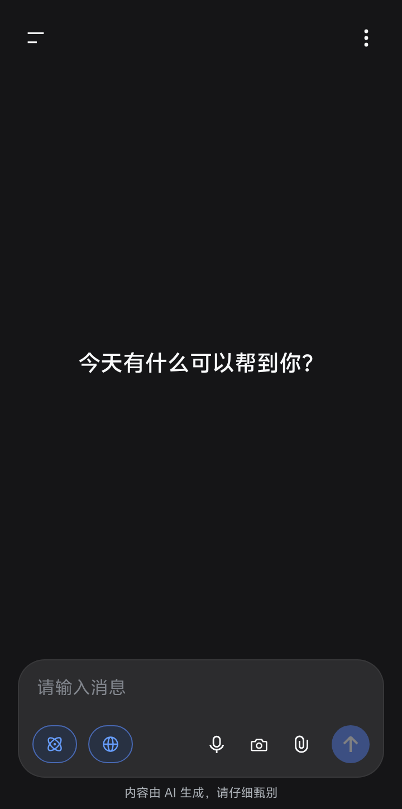

# DS Demo —— DeepSeek 原生壳 App（Capacitor）

> 给接手者/另一个会话的完整交接说明见 [`HANDOVER.md`](HANDOVER.md)（目录结构、重建流程、环境坑、硬约束都在里面）。

## 直接下载安装

| 版本 | 说明 | 下载 |
| --- | --- | --- |
| **v1.0.3**（最新） | 个性化设置页：自定义系统提示词、思考强度 5 档、保存/恢复默认 | [**DS-Demo-v1.0.3.apk**](https://github.com/Gleam1031/ds-demo/releases/download/v1.0.3/DS-Demo-v1.0.3.apk) |
| v1.0.2 | 拍照上传、附件查看器修复、相机图标修正、个性化入口 | [DS-Demo-v1.0.2.apk](https://github.com/Gleam1031/ds-demo/releases/download/v1.0.2/DS-Demo-v1.0.2.apk) |
| v1.0.1 | 新增聊天记录搜索、对话置顶、附件查看器修复 | [DS-Demo-v1.0.1.apk](https://github.com/Gleam1031/ds-demo/releases/download/v1.0.1/DS-Demo-v1.0.1.apk) |
| v1.0.0 | 首个公开版本（含首次启动引导页） | [DS-Demo-v1.0.0.apk](https://github.com/Gleam1031/ds-demo/releases/download/v1.0.0/DS-Demo-v1.0.0.apk) |

装好后首次打开会引导你填入**自己的 DeepSeek API Key**（按量计费，与 App 作者无关）。全部版本见 [Releases](https://github.com/Gleam1031/ds-demo/releases)。

> 本应用为非官方打包，不隶属于 DeepSeek，也未获其背书。

把 DeepSeek 官方开源前端 [`deepseek-ai/chat-demo`](https://github.com/deepseek-ai/chat-demo)（MIT）的静态构建产物，封装成 Android / iOS 原生壳应用。

- **技术栈**：Capacitor 8.6.2（不使用 Cordova）
- **不修改 chat-demo 源码**：chat-demo 本身就是可静态托管的单页应用，这里只消费它的 `dist/`
- **离线可打开界面**：`capacitor.config.json` 中未配置 `server.url`，界面从 App 本地加载；只有 API 调用需要联网

## 目录结构

本壳项目与 chat-demo 源码是**同级独立目录**，互不侵入：

```
deepseek-app/
├── chat-demo/              # 官方源码（仅用于构建 dist，未做任何修改）
│   └── dist/               # pnpm build 产物
└── deepseek-shell/         # ← 本交付物：原生壳项目
    ├── dist/               # 从 chat-demo/dist 复制来的静态站点（webDir）+ 壳层注入文件
    ├── scripts/            # 壳层增强脚本（关于页注入、许可清单生成）
    │   ├── apply-shell-ui.mjs      # 把「关于」入口注入 dist（幂等）
    │   ├── gen-notices.mjs         # 生成 THIRD_PARTY_NOTICES.txt
    │   ├── bundled-packages.json   # rspack 实测的"被打进产物的包"清单
    │   └── ui/shell-about.{js,css} # 「关于」按钮与面板
    ├── THIRD_PARTY_NOTICES.txt     # 随发布包分发的第三方许可声明（含 BOM）
    ├── capacitor.config.json
    ├── package.json
    ├── android/            # Android 工程（Gradle wrapper 已就位）
    ├── ios/                # iOS 工程（Capacitor 8，Swift Package Manager，无需 CocoaPods）
    └── docs/               # 渲染预览截图
```

## 已验证

| 项目 | 结果 |
| --- | --- |
| `dist/index.html` 存在 | ✅ 414 B；整站 153 个文件 / 4.19 MB |
| 复制后产物一致 | ✅ 逐字节一致（4,395,125 B） |
| `webDir` 为 `dist` | ✅ |
| 未配置 `server.url` | ✅ 全工程无 `server` 字段 |
| `npx cap add android` / `ios` / `cap sync` | ✅ 全部成功 |
| chat-demo 源码未被改动 | ✅ `git status` 干净（`dist/` 本就在 `.gitignore`） |
| 界面在 390×844 手机视口渲染 | ✅ 无横向溢出（见下方预览） |
| API 跨域放行 WebView 来源 | ✅ `https://localhost`（Android）与 `capacitor://localhost`（iOS）预检均返回 200 且回显该 Origin |
| 「关于」入口（真机 720×1608） | ✅ 主页右上角 ⋮；进入会话页后自动让位到「新对话」左侧（`right:10px` → `right:62px`） |
| 许可声明随包分发（真机） | ✅ APK 内 `assets/public/LICENSE` + `assets/public/THIRD_PARTY_NOTICES.txt`（208 KB / 95 个第三方包），关于页可滚动阅读全文 |
| 改名后的共存（真机） | ✅ 显示名 **DS Demo**、包名 `com.dsdemo.shell`；与旧包 `com.deepseek.shell` 并存，旧包 `firstInstallTime` 未变（未被覆盖） |
| 导入历史对话（真机） | ✅ 设置 → 数据管理 → 上传，实测导入 DeepSeek 导出的官方 ZIP（`export_format_version: 3`）；会话、附件与消息分支字段均完整落地，界面正常渲染 |
| 首启引导页（真机） | ✅ 无 Key 的新装用户首启进入引导页；已有 Key 则自动跳过 |
| 引导页外链（真机） | ✅ 点击后前台切换为 `com.vivo.browser/.BrowserActivity`，走**系统浏览器**打开官网，App 界面不被顶掉 |

手机视口渲染预览（390×844，由本地静态服务 + 无头浏览器实测）：

| 首次启动：填 API Key | 聊天主界面 |
| --- | --- |
|  |  |

真机实拍（**已裁掉系统状态栏与底部导航栏**，不含时间/电量/通知图标等手机信息）：

| 主页右上角 ⋮ 入口 | 点开后的「关于 / 开源许可」 |
| --- | --- |
|  |  |

首次启动引导页（真机，裁掉系统栏，同一页的上/下两屏）：

| 上半：为什么需要 Key + 官网三步 | 下半：粘贴保存 / 稍后再说 |
| --- | --- |
|  |  |


## 首次启动引导页

没有 API Key 的人打开 App 会一脸茫然（不知道 Key 是什么、去哪申请、拿到往哪填）。所以首次启动会显示一屏引导：

1. 一句话解释 API Key 是什么、按量计费；
2. **官网三步操作**：注册/登录 → 创建 API Key（提醒"只显示一次，先复制"）→ 充值；
3. 一个「去 DeepSeek 官网申请 API Key」按钮（**系统浏览器**打开官方页面）；
4. 一个输入框 + 「保存并开始聊天」，保存后直接进聊天，不用自己去找设置；
5. 「稍后再说」则落回 chat-demo 自带设置页（那里也有输入框），不会卡死。

仅当**本地没有 Key 且未点过跳过**时出现；已有 Key 的用户不会被打扰。

> 实现方式：`scripts/ui/shell-onboarding.js` 注入，不改 chat-demo 源码。保存时写入它自己的存储键 `chat-demo:api-key` 后 `location.reload()` —— 这是对上游内部实现的依赖，详见 `HANDOVER.md` 第 5.3 节。

## 本地增强（聊天记录搜索 / 置顶 / 附件省略提示）

这三项改了 chat-demo 源码，统一记录在 `patches/0001-chat-demo-customizations.patch`，用 `node scripts/apply-chat-demo-patches.mjs` 幂等应用。

**① 聊天记录搜索**
侧边栏「开启新对话」上方新增「搜索聊天记录」（同尺寸的次要按钮）。点开是搜索弹窗：按**标题和消息正文**匹配，结果带命中片段，点一条直接跳转到该会话。数据直接读本机 IndexedDB，不上传任何内容。

**② 对话置顶**
- 桌面端：会话右侧「更多」菜单 → 「置顶 / 取消置顶」；
- 触屏：**长按会话标题** 450ms 弹出同一个菜单（移动端原本只有当前会话显示「更多」按钮，长按补齐了入口）；
- 置顶的会话排在最前的「置顶」分组，标题右侧显示图钉；置顶状态存 `localStorage['chat-demo:pinned-sessions']`。

**③ 附件超出上限的提示**
一次请求最多能引用 20 个 document 块（含历史附件，服务端限制）。超出时现在会：
- 只发送最新的 20 个，较早的替换为文字占位，**整轮对话不再失败**；
- 同时弹出一条 toast：`已省略 N 个较早的附件：单次请求最多引用 20 个文档`，避免用户误以为模型漏读附件。

**④ 附件查看（修复"点开附件回不来"）**
chat-demo 用 `blob:` URL 打开附件，而 Capacitor 的 WebView 既不能把 `blob:` 交给系统应用，又会把它就地加载——结果 App 界面被文件内容替换，只能杀掉重进。现在由壳层 `scripts/ui/shell-file-viewer.js` 拦截：
- 图片 → 应用内全屏查看，点图片 / 右上角 ✕ 即可返回；
- 其他类型 → 显示文件信息与「返回聊天」，不再丢界面。



**⑤ 个性化**
设置 → 通用设置 → 「位置信息」下方「个性化」，点击进入子页面（弹窗内，可「返回」）：

- **系统提示词**：宽度固定整行，**高度随内容自适应**（一行起，写多少行长多高）。留空时框内显示灰色默认提示词「该助手为DeepSeek，由深度求索公司创造。」；输入后文字跟随主题色，并作为每次请求的 `system` 字段发送。**边框跟随主题黑/白**（浅色=黑 42%、深色=白 42%），深色模式下也清晰可辨。
- **思考强度**：5 档滑杆（最低 / 较低 / 标准 / 较高 / 最高），轨道为 `#6699FF → #B899FF` 横向渐变、24px 粗（滑块 20px 嵌在轨道内）；映射到 `thinking.budget_tokens` = 1024 / 2048 / 4096 / 6144 / 8192，仅在开启「深度思考」时生效。
- **恢复默认设置 / 保存修改设置**：两个等宽按钮并排（左：次要描边，右：主色）。面板内改动先落草稿，**点「保存修改设置」才写入并生效**；未保存就返回则丢弃。「恢复默认设置」会立即恢复并保存（提示已恢复）。

> 修复记录：滑杆原先在手机上拖不动，根因是 `viewport.ts` 里防止整页滚动的全局 `touchmove` 对滑杆做了 `preventDefault`；现在对 `input[type=range]` 放行。



**⑥ 拍照上传**
输入框工具栏在「语音」与「上传文件」之间新增相机按钮：点击直接唤起系统相机（`<input type="file" accept="image/*" capture="environment">`），拍完确认后照片走与普通图片附件完全相同的上传/预览链路。



- Android 侧**无需**声明 `CAMERA` 权限：Capacitor 在 App 未声明该权限时直接走 `ACTION_IMAGE_CAPTURE`，由相机 App 处理拍照；
- 桌面浏览器上 `capture` 会被忽略，退化为"仅选择图片"的文件选择框。

## 填入 API Key

首次启动会先显示上面的**引导页**：照着三步去官网拿 Key，回来粘贴进输入框即可；点「稍后再说」则会落到官方 demo 自带的「设置」面板，那里同样有输入框。

- Key 通过官方 demo 自己的设置页保存在本机 WebView 存储（localStorage），**不经过本壳项目的任何代码**，也不会打包进 APK/IPA
- 之后可随时从左上角菜单 → 设置重新修改
- Key 请从 <https://platform.deepseek.com/api_keys> 获取

## 构建 Android

前提：安装 **JDK 17+（建议 21）** 与 **Android Studio**。工程使用 AGP 8.13.0 / Gradle 8.14.3，`compileSdk`/`targetSdk` = 36、`minSdk` = 24，缺什么 SDK 平台 Android Studio 会提示下载。

```bash
npx cap open android        # 打开 Android Studio，然后 Build > Build APK(s)
```

命令行直接出调试包（无需打开 Studio）：

```bash
cd android
gradlew.bat assembleDebug        # macOS/Linux 用 ./gradlew assembleDebug
# 产物：android/app/build/outputs/apk/debug/app-debug.apk
```

装到设备：`adb install -r app-debug.apk`。

> 本机环境说明（2026-11-16 已配置完成）：JDK 21（`C:\Android\jdk-21`，Microsoft OpenJDK 21.0.13）与 Android SDK（`C:\Android\Sdk`，platform-tools 37.0.1 / build-tools 36.0.0 / platform android-36）已安装并持久化到用户环境变量。`gradlew.bat assembleDebug` 已实测通过，产物 `app-debug.apk` 5.89 MB（`com.deepseek.shell`，minSdk 24 / targetSdk 36）。Android Studio 未安装，仅命令行构建可用。

## 构建 iOS

**必须在 macOS + Xcode 上进行**（Windows 只能生成工程，无法编译 iOS）。

```bash
npx cap open ios            # 打开 Xcode
```

在 Xcode 中选好 Team（Signing & Capabilities）、连接真机或模拟器后 Run / Archive。Capacitor 8 通过 Swift Package Manager 拉取依赖，**不需要 CocoaPods**。

## 改了 web 产物之后

```bash
npm run sync                # = npx cap sync：把 dist/ 重新拷进两个平台并更新插件
```

只改 `dist/` 内容时也可以 `npx cap copy`。

## 重新生成 dist（如需更新到新版前端）

要求 **Node.js ≥ 22.12** 与 pnpm：

```bash
cd chat-demo
pnpm install
pnpm build
```

**Windows 注意**：chat-demo 的 `build` 脚本写的是 `rm -rf dist && NODE_ENV=production rspack ...`，这是 POSIX 写法，在 `cmd.exe` 下会报 `'NODE_ENV' 不是内部或外部命令`。三种解法任选：

1. 用 Git Bash 执行 `pnpm build`（本次即如此）；
2. 或者等价地直接跑底层命令（不修改源码）：
   ```powershell
   Remove-Item dist -Recurse -Force
   $env:NODE_ENV="production"
   npx rspack build -c rspack.config.ts
   ```

构建完成后把 `chat-demo/dist/` 整个复制覆盖 `deepseek-shell/dist/`，**然后必须重新跑一次壳层增强**（否则「关于」入口会丢）：

```bash
node scripts/gen-notices.mjs      # 重新生成许可清单（依赖变化时尤其需要）
node scripts/apply-shell-ui.mjs   # 重新注入「关于」入口
npx cap sync
```

## 「关于」页与开源许可

主页右上角有一个**竖三点 ⋮** 入口，点开是「关于 / About」面板，内含应用信息与完整许可全文。

实现方式（**不修改 chat-demo 源码**）：在 `dist/` 上做壳层注入——`dist/shell-about.js` 把按钮挂在 `body` 上（不动 React 渲染的顶栏），样式复用 chat-demo 自己的主题变量，所以明/暗主题自动协调。

- **位置自适应**：主页右上角本来是空的，按钮贴右（`right:10px`）；进入会话页后右上角有「新对话」按钮，按钮会**自动让位到它左侧**（`right:62px`），不会重叠
- **层级 940**：高于正文、低于 chat-demo 自己的弹窗（1000+），所以设置弹窗打开时会自然盖住它
- 触屏上不会出现 `:hover` 粘住的灰底（hover 样式包在 `@media (hover: hover)` 里）

许可清单 `THIRD_PARTY_NOTICES.txt` 由 `scripts/gen-notices.mjs` 按 `scripts/bundled-packages.json` 生成，而这份清单来自构建期 **rspack 模块统计实测**（真正被打进产物的 95 个第三方包），不是靠 package.json 猜的。生成后会写入两处：

- `dist/THIRD_PARTY_NOTICES.txt` —— App 内「关于」页读取
- `THIRD_PARTY_NOTICES.txt` —— 独立文件，**随发布包一起分发**（带 BOM，Windows 记事本/Excel 打开不乱码）

`bundled-packages.json` 可在依赖变化后重新生成（会读 ../chat-demo 的 rspack 配置做一次统计构建，但不改其源码/产物）：

```bash
node scripts/gen-bundled-packages.mjs   # ← 重新统计"实际打包的包"
node scripts/gen-notices.mjs            # ← 再生成许可清单
node scripts/apply-shell-ui.mjs         # ← 重新注入关于页（清单文本已换）
npx cap sync
```

> 注：少数 `micromark-*` 包发布时本身就没带 LICENSE 文件，清单中会标注其 `license` 字段与上游仓库地址。

## 原生侧改动说明

为让 demo 自带的**语音输入**在原生 WebView 里可用，仅在壳工程的原生配置中补了麦克风权限（**没有改动 chat-demo 源码**）：

- `android/app/src/main/AndroidManifest.xml`：`RECORD_AUDIO`、`MODIFY_AUDIO_SETTINGS`（Capacitor 会在 WebView 请求录音时自动弹运行时授权）
- `ios/App/App/Info.plist`：`NSMicrophoneUsageDescription`

## 命名与商标

| 项 | 值 |
| --- | --- |
| 应用显示名 | **DS Demo** |
| Android `applicationId` / iOS Bundle ID | `com.dsdemo.shell` |
| 包内 WebView 来源 | `https://localhost`（Android）/ `capacitor://localhost`（iOS） |

代码是 MIT 许可，但 **MIT 不授予商标使用权**，所以本项目的命名刻意避开品牌名：

- App 名、包名、桌面图标均不含 `DeepSeek`
- `DeepSeek` 在本项目文档与关于页中**仅用于说明来源**（"基于 DeepSeek 开源项目 chat-demo 封装"）
- 关于页与许可清单均明确声明**非官方、与 DeepSeek 无关联**

> 若你自行 fork 分发：请保留上述归属与免责声明，并继续避免把 `DeepSeek` 用在仓库名/应用名等品牌位。本 README 不构成法律意见。

> 包名从早先的 `com.deepseek.shell` 改成了 `com.dsdemo.shell`，因此它是一个**独立的应用**：与旧包可同时安装，互不影响数据。

## 已知限制

1. **聊天记录只存在本机**：demo 用 IndexedDB / localStorage 保存在 WebView 里，卸载 App 即清空。重要对话请用设置页的「导出所有历史对话」备份（支持导出/导入 ZIP）。
2. **API Key 明文存于本机存储**：与官方 demo 行为一致，适合个人设备；多人共用设备请勿保存长期 Key。
3. **必须联网**：界面可离线打开，但对话、朗读（DeepSeek TTS）、附件上传都要访问 `https://api.deepseek.com`。
4. **朗读依赖网络 TTS**：不是系统语音合成，离线不可用。
5. 若后续给 `capacitor.config.json` 添加了 `server.url`，App 会改为从远程加载、失去本地壳的意义 —— 本项目刻意不配置它。
